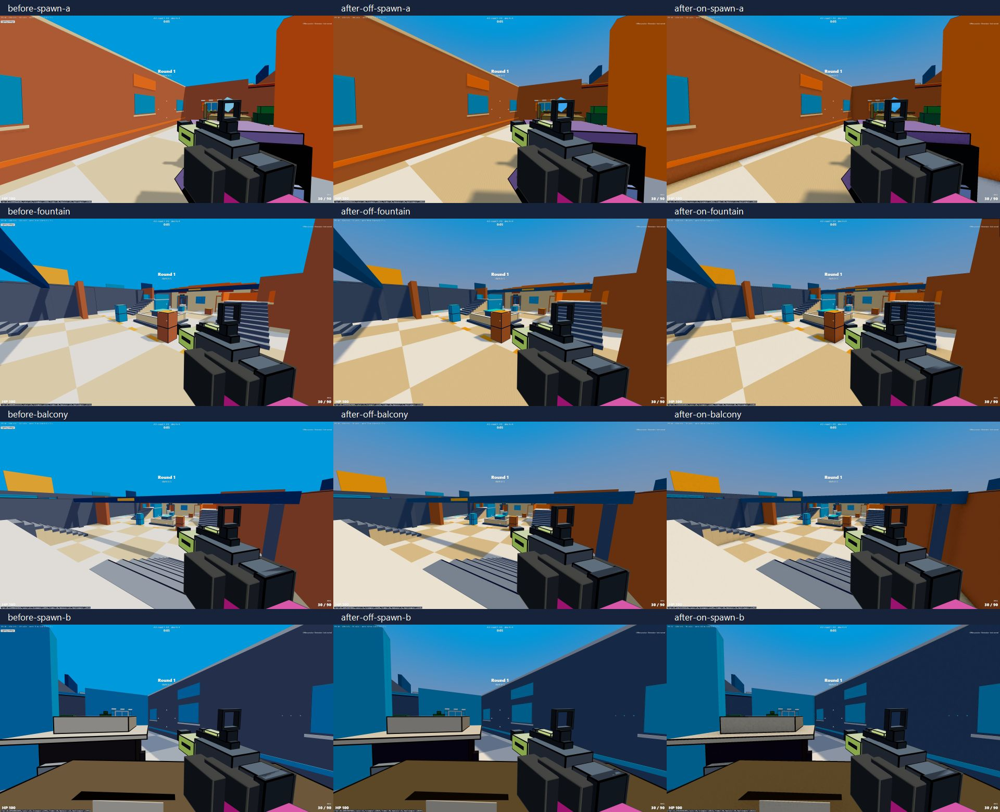
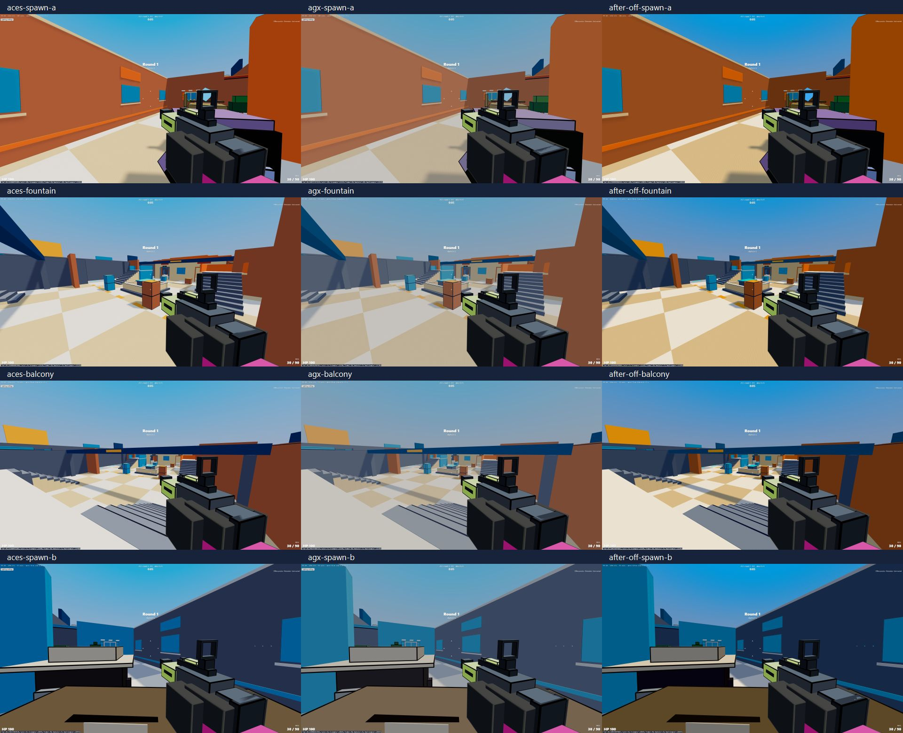
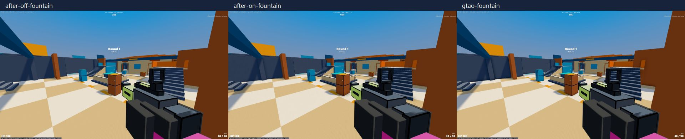

# Voxel Arena lighting review — 2026-11-03

## Result

Neutral tone mapping, one-draw camera-centred gradient sky, fixed world-space PCF sun shadows, and optional half-resolution n8ao. Default AO is **off** because the measured AO run does not sustain 60 FPS. No map data, character, weapon, gameplay, network or server source changed; no commit was created.

## Measurements

Same four fixed camera positions and default game FOV (90). All eight actors are present; the debug `view` query freezes offline simulation so camera/lighting comparisons are not disrupted by combat. Random starting loadouts and elapsed idle animation can slightly change culling/counts between runs. 30 warm-up frames, then 90 frames, FPS = frames / elapsed RAF time. These are graphics comparison runs, not a guarantee for a live network match. The normal offline game was separately opened and showed 60 FPS after warm-up.

The browser viewport override requested 1280×720; the backend subsequently reported a 2560×1440 CSS/drawing canvas. PNG evidence is captured at 1280×720 by the browser screenshot API. Treat these as measurements of this test browser, not a certified 1280×720 GPU benchmark or a promise for every laptop.

Counters now include **all** world/shadow/post passes plus the separate weapon pass: gl.info.autoReset=false with one explicit reset per frame. Old HUD counters could omit shadow submissions.

| View | Before FPS / calls / triangles | After AO off | After AO on |
|---|---:|---:|---:|
| spawn-a | 60.2 / 143 / 135,960 | 60.2 / 104 / 130,922 | 48.1 / 111 / 130,929 |
| fountain | 60.2 / 114 / 127,752 | 60.2 / 73 / 121,598 | 46.7 / 80 / 121,605 |
| balcony | 60.2 / 117 / 128,436 | 60.2 / 76 / 122,246 | 49.1 / 78 / 121,497 |
| spawn-b | 60.2 / 135 / 135,492 | 60.2 / 92 / 128,654 | 51.3 / 98 / 128,121 |

## Choices and rejected options

- **Neutral** preserves the orange, cyan and mustard saturation best in the four side-by-side views. ACES compresses/desaturates bright colours; AgX is visibly softer and more muted here. All three ran around 60 FPS with AO off; screenshots are the basis of this art judgement, not a measured perceptual colour-error metric. Exposure stays 1.
- **n8ao 2.0.1 + postprocessing 6.39.6:** selected for tight contact shading at stair joints, cover bases and awnings, without a second normal-render of all geometry. HalfRes, 8 AO samples, 4 denoise samples, one denoise iteration; radius .65m, intensity1.8. Transparency auto-detection is disabled: it otherwise triggers two additional scene passes for glass/effects. Transparent beauty colour is retained; transparent-specific AO is omitted. The depth-writing world remains occluded.
- **GTAOPass (installed Three addon):** tested at full resolution with 8 samples and 4 denoise samples, radius .65m. It gives usable corner shading, but adds a normal prepass of the world and exceeds both frame budgets here. Half-resolution processing could reduce its pixel cost, but would not remove the extra geometry submissions. Kept only as a debug review backend.

| AO option, fountain | FPS | Draw calls | Triangles |
|---|---:|---:|---:|
| after-off | 60.2 | 73 | 121,598 |
| after-on | 46.7 | 80 | 121,605 |
| gtao | 34.2 | 142 | 241,113 |

- **Baked vertex AO:** attractive zero-pass runtime cost, but would alter final map geometry/vertex data; outside the authorised scope, and would not react to moving actors.
- **Light probes:** useful diffuse fill, not a replacement for wall-floor occlusion. Existing map hemisphere fill is retained.
- **@react-three/postprocessing:** adds a wrapper around the composer; the game already owns a manual two-scene render pipeline, so direct composer integration is simpler and makes world/viewmodel ordering explicit.
- **CSM/VSM:** not selected. The map is compact, with a stationary sun. CSM repeats caster draws and is unnecessary for the measured result; VSM introduces extra filtering/bleeding tradeoffs. Keep a fixed 2048 PCF map, extent48m, bias−.0002, normalBias.025, radius2. Every map mesh (four chunks and two instanced detail families) casts and receives shadows. The light/frustum do not follow camera motion, avoiding moving shadow texel grids.

To retain the draw-call budget, dynamic character sun shadows use head + torso; arms/legs and small held weapon boxes do not cast separate sun shadows. Their rendered geometry, materials, holds and animation are unchanged. This is a deliberate shadow-detail tradeoff. All buildings and window/awning assemblies retain their shadows.

## Integration and checks

- Same WorldRenderer hook in GameApp and OnlineApp; MapView is shared. An actual online match was not connected during this review; online integration is shared-code/typecheck proof.
- World composer finishes first; depth is cleared and the existing viewmodel scene is rendered afterwards with its original ACES mapping. No AO/composer is applied to that scene.
- Settings `ambientOcclusion` follows the existing on/off store, load/save, defaults and select pattern. Tested on → off in the real Settings panel without reload. Off calls the direct renderer and executes zero composer/AO passes. Cached AO resources stay available for later re-enable.
- Construction and resize allocate resources outside useFrame. Frame code reuses camera/vector/uniform objects and pre-created traversal callbacks. No React state or new object constructors added in either frame loop.
- `npm run typecheck`: PASS. `npm run test:gameplay`: PASS, 19 checks. `npm run game:build`: PASS. Existing `game:preview` server on5191 served the rebuilt production app; starting another copy reported port-in-use, so the existing instance was reused.
- Browser console: **0 errors** across reviewed modes and normal offline play. Existing Clock/Rapier deprecation warnings remain.
- package.json adds only exact n8ao2.0.1 and postprocessing6.39.6; scripts and package-lock.json are unchanged. To install within this strict file scope use `npm install --package-lock=false`; lockfile synchronisation for an npm-ci workflow remains outside the authorised edits. Installed n8ao package metadata declares ISC (rather than assuming CC0 from the brief).

## Reproduce

Build and open `http://127.0.0.1:5191/?offline=1&debug=1`. Review query examples: `&view=spawn-a&ao=off`, `&view=fountain&ao=on`, `&view=balcony&tone=agx&ao=off`, `&view=spawn-b&lightingReview=before&ao=off`. Views are debug-only and freeze offline simulation. GTAO comparison: `&view=fountain&ao=gtao`. The review-only Lighting settings button opens the same Settings panel. Remove view to restore ordinary gameplay. All tunable numbers and camera coordinates are in LIGHTING / RENDER in src/config/game.ts.

## Evidence

## Changed/new files

Copy these code/config/doc files (all allowed by the one-time scope):

- [client/game/GameApp.tsx](D:/voxel-arena/client/game/GameApp.tsx)
- [client/game/OnlineApp.tsx](D:/voxel-arena/client/game/OnlineApp.tsx)
- [client/game/postfx.ts](D:/voxel-arena/client/game/postfx.ts)
- [client/game/sky.ts](D:/voxel-arena/client/game/sky.ts)
- [src/config/game.ts](D:/voxel-arena/src/config/game.ts)
- [src/config/settings.ts](D:/voxel-arena/src/config/settings.ts)
- [src/ui/settings.ts](D:/voxel-arena/src/ui/settings.ts)
- [src/ui/settingsPanel.ts](D:/voxel-arena/src/ui/settingsPanel.ts)
- [package.json](D:/voxel-arena/package.json)
- [docs/GAME.md](D:/voxel-arena/docs/GAME.md)

New evidence/report files (not runtime dependencies):

- docs/lighting-report.md (moved from client/game/ on integration; evidence converted to JPG in docs/evidence/)

Sources: [n8ao README](https://github.com/N8python/n8ao), [postprocessing](https://github.com/pmndrs/postprocessing), [GTAOPass](https://threejs.org/docs/pages/GTAOPass.html), [Three lighting skill](https://github.com/gamedev-skills/awesome-gamedev-agent-skills/tree/main/skills/web-engines/threejs-materials-lighting), [Three scene setup skill](https://github.com/gamedev-skills/awesome-gamedev-agent-skills/tree/main/skills/web-engines/threejs-scene-setup). Installed r186 addon source and exact npm package README/APIs were checked.

Integration note (Claude, 2026-11-03): the GTAO review backend was removed from the game build (rejected option; reproduce from git history if needed). Shadow policy traversal now runs every `LIGHTING.shadowPolicyEvery` frames. package-lock.json synced with `npm install`.
