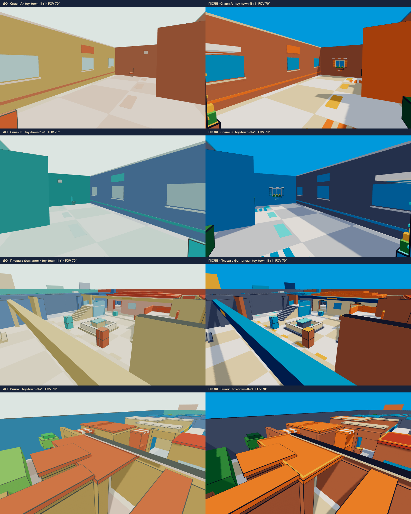

# Toy Town colour pass — 2026-11-01

Applied to all five maps. Endesga 32 only: [official palette](https://lospec.com/palette-list/endesga-32). Warm terracotta/orange/mustard A; turquoise/blue/slate B; light readable floors. Sun 2.8, ambient 0.9, optional hemisphere fill 0.85. The public API and all existing fields remain compatible. New optional sky.horizon and light.hemisphere are documented in README.

## Validation

`node src/maps/verify.mjs` **PASS**, including all five colour/collider/nav guards, 33-character contrast checks, shared geometry/material/disposal, SHA-256, bounds, symmetry, reachability, routes, chokes, loot, spawn safety and lane LOS. `npm run typecheck` **PASS** (game + server). 82 protected non-map source/config files and all existing public function signatures remain unchanged. Historical M1/M2 snapshots remain unchanged.

## Map budgets and contrast

| Map | Direct draws before → after | Triangles before → after | Logical boxes | JSON KiB | Low contrast pairs before → after |
|---|---:|---:|---:|---:|---:|
| toy-town | 52 → 6 | 24,768 → 36,480 | 1616 | 301.4 | 38 → 10 / 990 |
| toy-town-l1-r1 | 42 → 6 | 40,584 → 49,032 | 1812 | 386.8 | 35 → 11 / 990 |
| toy-town-l1-r2 | 42 → 6 | 40,728 → 49,656 | 1794 | 378.7 | 35 → 11 / 990 |
| toy-town-l2-r1 | 42 → 6 | 40,704 → 48,240 | 1796 | 385.8 | 36 → 10 / 990 |
| toy-town-l2-r2 | 42 → 6 | 40,848 → 49,392 | 1792 | 378.0 | 36 → 10 / 990 |

Four static quadrants plus two window InstancedMesh batches. One shared Lambert material, no textures or additional render materials. Static small prefabs are baked into quadrants at construction; the complex repeated window/shutter/flower/awning assemblies use real GPU instancing. No per-frame map work. All runtime JSON assets are under 400,000 bytes.

### Real frame counters, active game map L1/R1

Same 1280×800 cameras, FOV70, ACES/sRGB, sun and shadows matching the game. These counters include map shadow submissions.

| View | Draws before → after | Submitted triangles before → after |
|---|---:|---:|
| spawn-a | 35 → 10 | 43,704 → 88,128 |
| spawn-b | 35 → 10 | 43,704 → 88,128 |
| fountain | 28 → 10 | 40,536 → 88,128 |
| market | 26 → 8 | 35,328 → 67,464 |

The complete game scene was not re-profiled: these are measured map costs, not a claim about total game frames with bots, effects and UI. Worst map contribution in the matched views is 10 draws / 88,128 submitted triangles including shadows, leaving 110 draws / 111,872 triangles within the 120 / 200k whole-frame budget for other game content. Coarser culling increases submitted map triangles in some views while cutting draw calls.

## Readability

The same contrast.ts CIE76/D65 method compares all 33 body colours to the three most common zone colours (990 pairs/map). Low-contrast pairs remain explicitly flagged; unlit data cannot guarantee rendered recognition. Main walls were changed from the closest brick/tan matches; minimum measured deltaE is now 5.44 on L1/R1. Characters were not changed. Full before/after tables are in the per-map contrast JSON and contrast.csv.

| L1/R1 character | Body | Surface | deltaE | Zones |
|---|---|---|---:|---|
| vibe-vibers-viber-31 | #B53B29 | #BE4A2F | 5.44 | West Gallery |
| vibe-vibers-viber-extra-9 | #267CB3 | #0099DB | 12.84 | Spawn B, Market Court, East Gallery, Balcony B |
| vibe-vibers-viber-extra-20 | #C0AF8C | #EAD4AA | 14.11 | Spawn A, Mid Square, North House, West Gallery |
| vibe-vibers-viber-32 | #A6AAAD | #C0CBDC | 14.21 | Spawn B, East Gallery |

## Authorised physical fixes

- Benches at x=±26.5, z=±8 move to z=±9.25; lamps at x=±28.5 move to z=±9. Both halves remain mirrored.
- Lane-variant crates at (±7.7, -22) move to (±11.45, -20.25), outside the walls and without creating narrow chokes. Base-map crates move to (±7.7, -22.75).
- Base-map screen origins move from x=±25.026 to ±28.325 while z remains ±20. Their long body is split at the house-wall intersection; only the covered wall interval and a 4mm junction gap are trimmed. The outside boundary junction is trimmed by 6mm. The existing cover line is preserved, avoiding new early spawn sightlines.
- R1 only: remove the two 3×1m stair-front counters at (±20.9,-28.7). Adjacent four posts move outward 0.05m, widening the newly opened entrance from 2.52m to 2.62m. All original three steps remain; each half has a 2.25m walk to the +0.59997m stage. R2 has no matching blocked flight.

No other collision boxes changed. New decor has collide=false / blocksShots=false. All spawns, zones, loot, bounds and killY are byte-equivalent data values. Exact collider and navigation equality after only the allowlisted fixes is recorded in geometry-guard.json. This does not claim nav is unchanged at the fixed obstacles themselves. Every named prop/wall penetration check and both R1 stair-entry checks pass. Full old/new positions: design.json.

## Four matched screenshots

- spawn-a: [before](before-spawn-a.png), [after](after-spawn-a.png).
- spawn-b: [before](before-spawn-b.png), [after](after-spawn-b.png).
- fountain: [before](before-fountain.png), [after](after-fountain.png).
- market: [before](before-market.png), [after](after-market.png).

## Transfer to the game

Only these seven runtime files are required. No package, client, character or weapon files changed.

- [buildMap.ts](D:/voxel-arena/src/maps/buildMap.ts)
- [types.ts](D:/voxel-arena/src/maps/types.ts)
- [data/toy-town.json](D:/voxel-arena/src/maps/data/toy-town.json)
- [data/toy-town-l1-r1.json](D:/voxel-arena/src/maps/data/toy-town-l1-r1.json)
- [data/toy-town-l1-r2.json](D:/voxel-arena/src/maps/data/toy-town-l1-r2.json)
- [data/toy-town-l2-r1.json](D:/voxel-arena/src/maps/data/toy-town-l2-r1.json)
- [data/toy-town-l2-r2.json](D:/voxel-arena/src/maps/data/toy-town-l2-r2.json)

Optional preview, verification and evidence files are listed exhaustively in FILES.md. Its manifest contains sizes and SHA-256 values. The existing render-plate limits now derive from the unchanged triangle ceilings; logical-box/collider/nav/draw-call limits remain active, and the new colour gate is stricter (<60k direct triangles / <=6 map draws).
